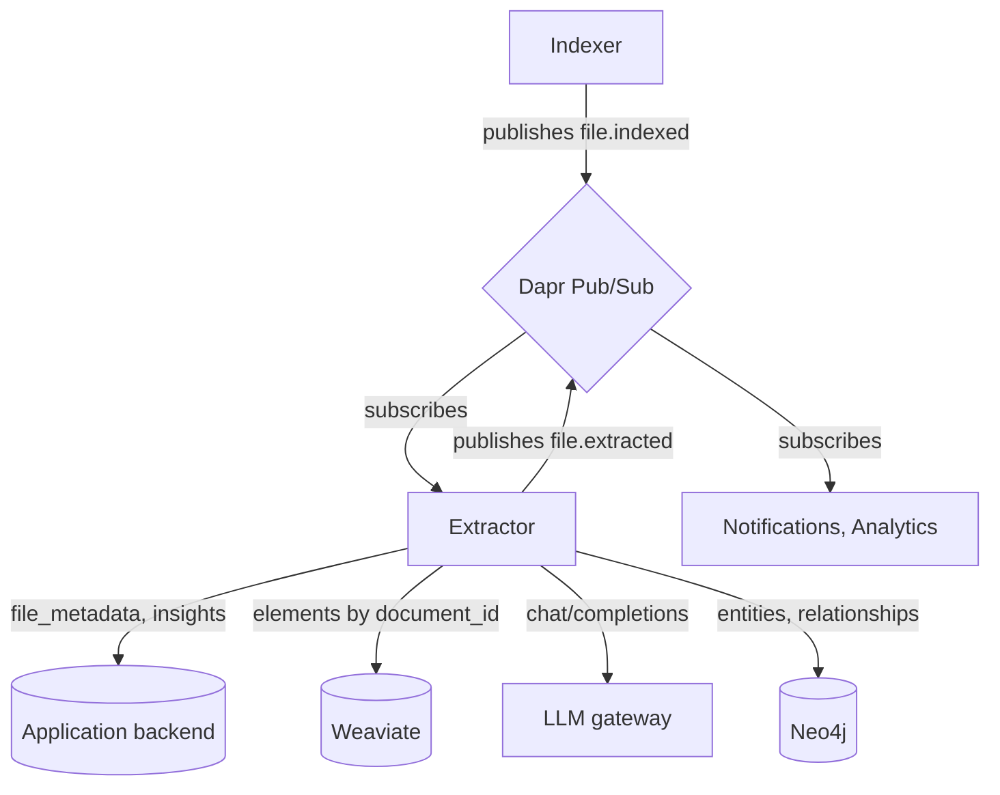

An LLM call inside an HTTP handler is a bet on the model's latency. Make it inside a request and the bet is on the gateway's timeout, on the caller's retry policy, and on whether the model gives the same answer twice. For a 200-page report, extraction is not a slow edge case. It is the expected case, and it runs on every file the platform ingests.

The Extractor is a microservice that refuses the bet. It subscribes to a `file.indexed` event, acknowledges it in under a millisecond, and runs the whole knowledge-extraction pipeline as a durable Dapr Workflow with its own retry granularity and its own idempotency keys.

Everything else in the service follows from that one decision: the way prompt constraints scale with the document, the way graph writes are scoped per tenant, the way the LLM key is fetched instead of read from the environment, and the way the trace crosses a thread boundary by hand because Python will not carry it for you.

This is a build log for one service in a document-intelligence platform. It is written for engineers who already know what a RAG pipeline is, and who want the operational detail: what the service does, why each constraint exists, and which failure modes the design actually removes rather than merely documents.

Two of the systems are named as roles rather than products. The document backend can be Directus, Appwrite, or Supabase, and the LLM gateway can be LiteLLM, Kong, Bifrost or Mozilla's Otari - the pattern does not change, because both sit behind a port. The vector store and the graph database are a specific choice, and this note treats them as such.

## 1. The pipeline

The Extractor is the second stage of ingestion. An Indexer microservice parses a file, chunks it into elements, and writes those elements to Weaviate. When it is done it publishes `file.indexed` on Dapr Pub/Sub. The Extractor picks that up, runs an LLM over the elements, and writes the result to two places: a knowledge graph in Neo4j and a structured record in the application backend.



The backend and the gateway are the swappable pair. Weaviate and Neo4j are the specific choice, and section 5 explains what that choice obliges you to build.

The service exposes no public REST API for extraction. There is exactly one meaningful endpoint, `POST /v1/events/file-indexed`, and it is called by the Dapr sidecar and nothing else. Health checks live on `GET /healthz` and `GET /v1/health`. Everything the service does happens inside one of nine steps:

| Step | Action | System | Notes |
| --- | --- | --- | --- |
| 1 | Fetch `file_metadata` | Application backend | Yields `file_id`, `uploaded_by`, `head_revision_id` |
| 2 | Fetch elements | Weaviate | Grouped by `document_id`, filtered by `workspace_id` |
| 3 | Classify elements | in-process | Narrative text vs. significant tables |
| 4 | Compute adaptive metrics | in-process | Constraints that scale with the document, see section 4 |
| 5 | Extract document knowledge | LLM gateway | One call over the concatenated narrative |
| 6 | Extract table knowledge | LLM gateway | One call per significant table |
| 7 | Write the graph | Neo4j | Delete-then-upsert, scoped per workspace |
| 8 | Create Insight records | Application backend | One per document, one per significant table |
| 9 | Deactivate superseded insights | Application backend | Soft delete of the previous revision |

Steps 1 to 8 are one unit of work. Step 9 is deliberately non-blocking: it runs after the new insights are committed, and a failure there is logged as a warning rather than failing the pipeline.

The service finishes by publishing `file.extracted`, and on the error path a `file.extraction_failed`. Both carry the workspace, so a downstream service never has to guess whose document failed.

## 2. Clean Architecture is the point, not the folder tree

The service is layered, and the layers are ordinary: domain, ports, application, adapters. The domain layer holds pure Pydantic models (`Insight`, `ExtractedEntity`, `ExtractionResult`) and the two domain events, with no dependency on a framework. The ports layer holds abstract base classes (`LLMClientPort`, `Neo4jRepositoryPort`, `WeaviateReaderPort`). The application layer holds the use case and the workflow. The adapters layer holds the concrete clients.

Only the port names carry a vendor. A stack with a different vector store would call that port `VectorStoreReaderPort`, and a stack with a different backend would call the gateway port `LLMClientPort` anyway, because that one was never product-specific to begin with. Nothing else in the layer would change, and the use case would not notice.

The dependency rule is the only part that matters:

```text
Adapters --(implement)--> Ports <--(use)-- Application --> Domain
```

Nothing points outward. The use case receives `WeaviateReaderPort` and `LLMClientPort` as constructor arguments and never learns whether it is talking to a real Weaviate cluster or a fake. That is not tidiness for its own sake: it is what lets the pipeline be tested without standing up a vector database, a graph database and an LLM gateway, and it is what makes swapping the gateway a change in one adapter rather than a rewrite.

The directory layout mirrors the rule one to one:

```text
src/
├── domain/       # pure Pydantic models and domain events, no external deps
├── ports/        # abstract interfaces the application needs
├── application/  # use cases, Dapr workflow, activities, API router
├── adapters/     # concrete implementations of the ports
└── prompt_templates/   # Jinja2 templates, versioned with the code
```

The [microservices guide](https://docs.jampuk.com/devops-engineering/microservices/) in the docs carries the same layout, the dependency rule and the testing checklist for every service in the platform.

## 3. The LLM call is a workflow, not a request handler

Here is the failure the workflow exists to prevent.

Dapr Pub/Sub delivers at least once. If the handler that receives `file.indexed` calls the LLM inline and returns after ninety seconds, one of three things happens: the sidecar times out the HTTP call and redelivers the event, the connection drops and the caller retries, or the run finishes after the sidecar has already given up - so a second copy of the same extraction is in flight while the first one is still writing. In every one of those cases the same document is billed twice and the same graph rows are written twice.

The fix is not a longer timeout. It is to stop doing the work in the request at all.

The handler validates the payload, checks idempotency, schedules a Dapr Workflow with a deterministic instance id, and returns `200 OK` immediately:

```python
instance_id = f"extract-{file_event.file_metadata_id}"

workflow_client.schedule_new_workflow(
    workflow=extract_insights_workflow,
    input={
        "event_data": data,
        "trace_id": trace_id,
        "otel_carrier": otel_carrier,
    },
    instance_id=instance_id,
)

return {
    "success": True,
    "status": "workflow_started",
    "event_id": event_id,
    "instance_id": instance_id,
}
```

The workflow itself is deliberately boring - two sequential activities:

```python
extracted_event_dict = yield ctx.call_activity(
    run_extraction_activity,
    input=input_data,
)

yield ctx.call_activity(
    publish_extracted_event_activity,
    input={
        "extracted_event": extracted_event_dict,
        "otel_carrier": input_data.get("otel_carrier", {}),
    },
)
```

Three properties fall out of this shape.

**Retry granularity is per activity.** A failed LLM call retries the extraction activity under the platform's resiliency policy, without re-running the event handler or the idempotency check. A failed publish retries only the publish, because publishing is a separate activity - otherwise a broker hiccup would re-run the expensive part of the pipeline.

**The instance id is the deduplication key.** `extract-{file_metadata_id}` is deterministic, so a redelivered event schedules an instance that already exists. The handler catches the duplicate-instance error and returns `duplicate_ignored` rather than raising, because raising would make Dapr retry the event that is already being processed.

**The handler acknowledges the event, not the work.** A `200` here means "received and scheduled", not "extracted". The only way to learn that extraction finished is to watch the `file.extracted` event, which is what downstream services do.

One sharp edge is worth naming. The workflow instance id is keyed on the file, while the finer-grained guard inside the use case is keyed on the file revision. When a document is revised and re-extracted, the coarse key and the fine key disagree, and the coarse one is what Dapr sees first. A platform that supports re-extraction on revision needs those two keys to move together.

The [Dapr service mesh guide](https://docs.jampuk.com/devops-engineering/dapr-service-mesh/) covers the pub/sub and resiliency configuration this relies on.

## 4. Shaping the request

Two decisions shape what the model is asked to do: how much output it is allowed, and what the unit of work is. Both are derived from the document, not fixed in the template.

### The output budget

The first thing that breaks is the prompt constraint. Write "a three-sentence summary with five bullet points" into the template and it is wrong twice. On a 90-character receipt, asking for five bullet points invites the model to pad - which is hallucination with a bulleted list on top. On a 100,000-character annual report, three sentences and five bullets throw away most of what was found. The instruction is fixed; the document is not.

So the constraints are computed, not written. Three output dimensions are derived from the character count of the text about to be sent - how long the summary may run, how many highlights are required, and how long one highlight may be. Each dimension is the same four-part construction:

- a curve with diminishing returns, so the tenth thousand characters of a document buy less than the first thousand did;
- a ceiling, so a very large document cannot ask for an unbounded answer;
- a floor, so a very small document cannot be asked for an empty one;
- a proportional minimum derived from the ceiling, so the model is never handed a range it cannot satisfy.

The proportional minimum is the one people get wrong: a fixed minimum produces prompts the model cannot satisfy on a short document, while a fraction of the maximum is always reachable. The curve family matters for the same reason - scale the budget linearly with the input and the model spends it restating.

The payoff is not accuracy. It is that one computation replaces a branching instruction, and two implementations of one rule drift - which is why the Jinja2 templates contain no conditionals at all. The constraints live in the domain model, are unit-testable without a model in the loop, and reach the template as integers:

```jinja
### 3. summary
Write {{ summary_min_sentences }} to {{ summary_max_sentences }} sentence(s) summarising the document.

### 6. key_highlights
Write {{ highlight_min_count }} to {{ highlight_max_count }} bullet points, each at most {{ highlight_max_chars }} characters.
```

One detail is easy to get backwards: the calculation uses the length before truncation, or the largest documents would receive the tightest budgets.

The constants are tuning, not derivation, so they are treated as configuration and versioned with the code. The wider argument - versioned templates, schema contracts, and budgeting the context window - is in [prompt and context engineering](https://docs.jampuk.com/ai-integrations/prompt-context-engineering/).

### The unit of work

The second decision is what one extraction covers, and getting it wrong is where a naive pipeline invents numbers. Concatenating a document into one text block is fine for prose and destructive for tables. A financial table flattened into narrative text loses its rows, its column headers and its meaning; the model summarises around it or invents the numbers.

The service splits the problem in two. Narrative elements (titles, narrative text, list items) are concatenated and sent as one document-level extraction. Tables are judged individually, by a significance test built from three independent signals - structural size, column count, and rendered length - combined so that any one of them is enough to qualify a table. Three signals rather than one is the design point: a single threshold either extracts navigation strips and layout tables, or misses a narrow table full of the numbers that matter. What clears the test earns its own model pass, `Insight` record, and entry in the `file.extracted` event; what does not is summarised as part of the document. The cut-offs are tuning, not derivation, and belong in configuration.

Each qualifying table is sent with a bounded window of the narrative immediately preceding it, because a table of figures is usually introduced by a sentence that says what the columns mean. Without that context, the extraction is confident and wrong. The window is walked backwards from the table, so the context is always the text that introduced it.

The cost consequence is worth naming. The number of model calls for a document is a function of its content, not of its size: a one-page memo is one call, a report with forty qualifying tables is forty-one. Nothing knows that number until the document has been parsed, which is why the work sits in a durable workflow.

## 5. Tenant isolation without tenant databases

The knowledge graph has to serve multiple workspaces from one Neo4j instance. The open-source community edition of Neo4j supports exactly one database, so "one database per tenant" is not on the table without changing the deployment model and the cost model with it. A managed graph service that sells per-tenant databases would let you skip all of section 5 - at a price, and at the cost of giving up a single portable deployment. I took the portable one.

Isolation is therefore enforced at the schema and query level, in three parts.

**Node identity includes the tenant.** Every node id is a digest taken over three inputs: the workspace, the entity type, and the normalised entity label. The order of those inputs, the normalisation and the digest itself are implementation detail. The contract that matters is one line: two tenants can never produce the same id for the same entity name.

Because the tenant is one of the inputs to the digest, the entity "Apple" in workspace A and the entity "Apple" in workspace B are two unrelated nodes with two unrelated ids. They cannot be merged by accident, and they cannot be joined by an id collision.

**Every node carries the tenant as a property.** `workspace_id` is written on every node and every relationship, so a filter is always possible even if the id scheme changes later.

**Every query filters on it.** Writes use `MERGE` on the id and then set the tenant. Deletes are scoped:

```cypher
MATCH (n:Entity {workspace_id: $workspace_id, source_document_id: $source_document_id})
-[r]-()
DELETE r
```

This is honest isolation, and it should be described accurately. The digest guarantees that two tenants' data cannot collide. It does not guarantee that a query cannot cross tenants - a Cypher statement that omits the `workspace_id` filter would still return the wrong rows, because the tenant is a property, not a partition. The guarantee holds because every statement in the adapter filters on it. That is a code-review rule, not a database constraint, and it is the kind of rule that needs an ADR and a test, not a comment.

The same reasoning applies to the Insight records in the application backend: the workspace id is on the document, the query filters on it, and the uniqueness constraint on `weaviate_uuid` prevents duplicates within a workspace.

## 6. The key is not an environment variable

The LLM gateway sits between the service and the model providers. It holds the provider credentials and does the routing. What the Extractor uses is not the same thing.

Gateway API keys are provisioned per workspace, at workspace creation time, by a function in the application backend. They are stored in the `workspaces` collection and referenced by the `llm_api_key_id` field. The extraction activity fetches the key for the workspace it is currently processing and injects it into the adapter:

```python
api_key = await workspace_repo.get_llm_key(event.workspace_id)

use_case = ExtractInsightUseCase(
    weaviate_reader=WeaviateReaderAdapter(client=weaviate_client),
    # Bifrost is the reference gateway. LiteLLM, Kong or Otari drop in here,
    # because only the endpoint and the credential shape are assumed.
    llm_client=BifrostLLMClientAdapter(api_key=api_key),
    ...
)
```

Two reasons this matters, one financial and one structural.

**Cost attribution.** Every call carries `X-LLM-Workspace-Id`, `X-LLM-Feature-Name` and `X-LLM-Sub-Feature` headers. With a single global key, the gateway can tell you how much the platform spent on extraction, and nothing about which customer spent it. With workspace-scoped keys, the number is attributable to a tenant on the same dashboard as the rest of the platform's usage.

**Blast radius.** A global key is a global secret. It sits in every deployment of the service, and any leak of it is a leak for every tenant. A workspace key is provisioned, rotated and revoked per tenant, and the exposure of one is the exposure of one.

The rule generalises past the gateway itself: any credential that belongs to a tenant should be fetched at the point of use, scoped to the tenant, and never pinned into an environment variable that every pod carries. The [model gateway guide](https://docs.jampuk.com/ai-integrations/model-gateway/) covers the adapter pattern this sits on top of.

## 7. Tracing that survives a thread boundary

The Extractor participates in the platform-wide OpenTelemetry trace, from the inbound event to the outbound one. Getting there took one non-obvious workaround.

Dapr's WorkflowRuntime dispatches activities on background gRPC worker threads. Python stores the active span in a `contextvars.ContextVar`, and `contextvars` do not cross thread boundaries. So the span created in the FastAPI handler is invisible inside the activity, and the activity's spans would arrive at the collector as a brand new trace. The tree would be disconnected exactly where you need it - between the event and the slow LLM call that caused the trouble.

The fix is to carry the context explicitly, as the W3C carrier dict that OpenTelemetry already defines:

```text
FastAPI handler (main thread)
  |
  |-- FastAPIInstrumentor creates the SERVER span
  |-- inject_context() serializes the active context -> {"traceparent": "00-..."}
  `-- schedule_new_workflow(input={..., "otel_carrier": carrier})
        |
        |-- extract_insights_workflow (Dapr generator)
        |     |
        |     |-- run_extraction_activity (background gRPC thread)
        |     |     |-- restore_context(carrier) re-attaches the parent span
        |     |     `-- tracer.start_as_current_span("run_extraction_activity")
        |     |           `-- ExtractInsightUseCase.execute() -> child spans for every step
        |     |
        |     `-- publish_extracted_event_activity (background gRPC thread)
```

Because Dapr workflow input has to be JSON, the carrier is serialised into the workflow payload and restored inside each activity. `restore_context()` returns a token that `detach_context()` cleans up in a `finally` block, so the restored context never leaks into the next activity on the same thread.

The resulting span tree is the operational artifact that matters:

```text
SERVER  POST /v1/events/file-indexed              [FastAPIInstrumentor]
  `-- INTERNAL  run_extraction_activity
        `-- INTERNAL  extract_insight.execute
              |-- INTERNAL  appwrite.get_file_metadata
              |-- INTERNAL  weaviate.get_elements
              |-- INTERNAL  classify_elements
              |-- INTERNAL  llm.extract_document
              |     `-- CLIENT  POST /v1/chat/completions  [LLM gateway]
              |-- INTERNAL  llm.extract_table[0]
              |     `-- CLIENT  POST /v1/chat/completions  [LLM gateway]
              |-- INTERNAL  neo4j.upsert_graph
              `-- INTERNAL  appwrite.create_insights
  `-- INTERNAL  publish_extracted_event_activity
```

`OpenAIInstrumentor` propagates the context to the outbound gateway calls, so the gateway's own spans land in the same trace. `FastAPIInstrumentor` excludes `/healthz`, so the liveness probe does not generate a span per probe per pod.

The general lesson is worth keeping: when you cross a thread boundary, a `contextvars`-based context is not inherited, and you have to carry it yourself. The pattern - serialise on the producer side, restore on the consumer side, detach in a `finally` - is the same one a queue consumer needs.

## 8. Idempotency is five mechanisms

Run the same file twice and you get duplicate graph nodes, duplicate Insight records and a bill for two extractions. Five separate mechanisms prevent that, at five different granularities, and none of them is sufficient alone.

| Layer | Mechanism | Granularity | Prevents |
| --- | --- | --- | --- |
| Event handler | Insight lookup before scheduling | Per file | Scheduling work that is already done |
| Workflow | Deterministic `instance_id` | Per file | Concurrent or duplicate schedules |
| Use case | Revision guard on `head_revision_id` | Per revision | Re-extracting an unchanged revision |
| Neo4j | `delete_by_document` before upsert | Per document | Duplicate nodes and relationships |
| Application backend | Unique index on `weaviate_uuid` | Per document and table | Duplicate Insight documents |

The revision guard is the subtle one. `file_metadata` carries a `head_revision_id`, the backend's `FileRevision` record that was current when the file was indexed. If an Insight already exists for that exact revision, the pipeline returns without calling the model. That is more precise than the file-level check in the handler, which cannot tell a re-upload from a re-index of the same content.

When a new revision is extracted, the previous revision's Insights are deactivated rather than deleted. Soft deactivation keeps the history of what was known about a document at a point in time, which matters when a question has to be answered about the state of a file last quarter. The deactivation runs after the new records are committed and is non-blocking - a failure there is logged and the pipeline still succeeds, because the authoritative data is already written.

## 9. The event contract

The inbound event is published by the Indexer and consumed by the Extractor:

| Field | Type | Meaning |
| --- | --- | --- |
| `workspace_id` | string | Workspace (tenant) id, the tenant scope for everything downstream |
| `file_metadata_id` | string | Backend `file_metadata` document id |
| `document_id` | string | Weaviate grouping key for the elements of one file |
| `element_count` | integer | Number of elements successfully indexed |
| `indexed_at` | string | ISO 8601 timestamp |

The outbound event is published after the graph is written and the Insight records exist:

| Field | Type | Meaning |
| --- | --- | --- |
| `insight_id` | string | Backend id of the document-level Insight |
| `table_insight_ids` | string[] | Backend ids of the table-level Insights |
| `category` | string | Primary business domain assigned by the model |
| `entity_count` | integer | Unique entities written to Neo4j |
| `relationship_count` | integer | Relationships written to Neo4j |
| `extracted_at` | string | ISO 8601 timestamp |

Two properties of the contract are deliberate. The payload carries counts and identifiers, not content - a downstream service can reconcile what happened without pulling the document itself. And the counts are exact: entities are deduplicated by id before the write, so `entity_count` is what landed in the graph, not what the model proposed.

A third event, `file.extraction_failed`, is published from the workflow's error branch once the platform's retries are exhausted. Without it, a failed extraction is a silent absence, and silent absences are the hardest kind of missing data to notice.

## 10. What I would tell a team building this

1. **Never call an LLM from an HTTP handler that a message broker is waiting on.** Acknowledge the event, schedule durable work, and let the work publish its own completion event.
2. **Scale the prompt constraints with the input.** A fixed instruction is wrong for both a receipt and a report. Scaling the budget with the input matches how much detail a document can actually carry.
3. **Keep the branching in code, not in templates.** One formula, one place, unit-testable without a model in the loop.
4. **Give tables their own extraction unit, with surrounding context.** Flattened tables are where summarisation quietly turns into fabrication.
5. **Put the tenant inside the entity identity, not just in a filter.** The digest makes collisions impossible; the filter is what keeps queries honest.
6. **Fetch tenant credentials at the point of use.** Cost attribution and blast radius both follow from that single rule.
7. **Carry trace context across thread boundaries explicitly.** `contextvars` will not do it for you, and a disconnected trace is worse than no trace.
8. **Implement idempotency at every layer that can be retried.** Five mechanisms, five granularities, none of them sufficient alone.
9. **Publish a failure event.** A pipeline that fails silently is a pipeline whose output is quietly wrong.

## 11. Glossary

- **Application backend** - Holds the document metadata, the Insight records and the workspace-scoped gateway key reference. Directus, Appwrite, or Supabase.
- **LLM gateway** - Provider-agnostic, OpenAI-compatible API, the only path to a model from the service. LiteLLM, Kong, Bifrost or Mozilla's Otari.
- **Dapr** - Distributed Application Runtime. Provides the pub/sub seam, the resiliency policies and the workflow engine.
- **Dapr Workflow** - Durable, resumable orchestration with per-activity retry, used here to run the extraction pipeline.
- **Insight** - The structured record of one extraction: summary, categories, highlights, tags, token count, processing time.
- **Instance id** - The deterministic identifier of a Dapr Workflow instance, used here as the deduplication key.
- **Weaviate** - The vector store holding the indexed elements this service reads.
- **Neo4j** - The graph store holding extracted entities and relationships, one database shared by all workspaces.
- **W3C carrier** - The serialised form of an OpenTelemetry context, used here to move a trace across a thread boundary.
- **Gateway attribution headers** - `X-LLM-Workspace-Id`, `X-LLM-Feature-Name`, `X-LLM-Sub-Feature`, which attach per-workspace cost attribution to a gateway call.

This is the unglamorous half of document intelligence: prompt arithmetic, tenant-scoped digests, retry semantics and trace plumbing. It is also the half that decides whether the system is trustworthy on the ten-thousandth file, not just the first. If your team is building this kind of pipeline, the [document intelligence engagements](https://www.jampuk.com/agentic-grid/document-intelligence/) are where I work on it directly, alongside Jampuk's [AI integrations](https://www.jampuk.com/solutions/ai-integrations/) and [DevOps engineering](https://www.jampuk.com/solutions/devops-engineering/) practices.

## Guides and references

- [Microservices](https://docs.jampuk.com/devops-engineering/microservices/) - Clean Architecture structure, the dependency rule and the testing checklist.
- [Dapr service mesh](https://docs.jampuk.com/devops-engineering/dapr-service-mesh/) - pub/sub, resiliency and the seam between services.
- [RAG pipeline design](https://docs.jampuk.com/ai-integrations/rag-pipeline-design/) - chunking, retrieval and grounding patterns for the other half of the pipeline.
- [Model gateway](https://docs.jampuk.com/ai-integrations/model-gateway/) - the adapter pattern behind the gateway client.
- [Prompt and context engineering](https://docs.jampuk.com/ai-integrations/prompt-context-engineering/) - versioned templates, schema enforcement and context budgeting.
- [Vector store options](https://docs.jampuk.com/ai-integrations/vector-store-options/) - where Weaviate sits among the alternatives.
- [LLM evaluation](https://docs.jampuk.com/ai-integrations/llm-evaluation/) - the offline suites that check an extraction pipeline still behaves.
