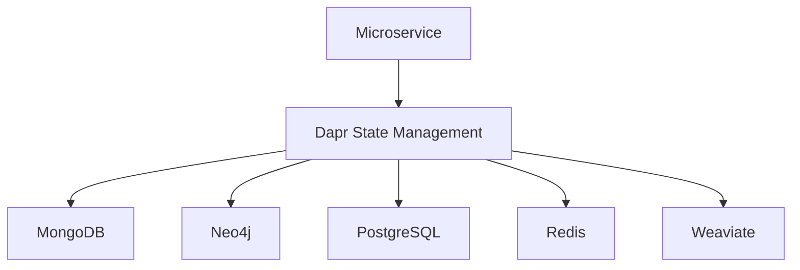
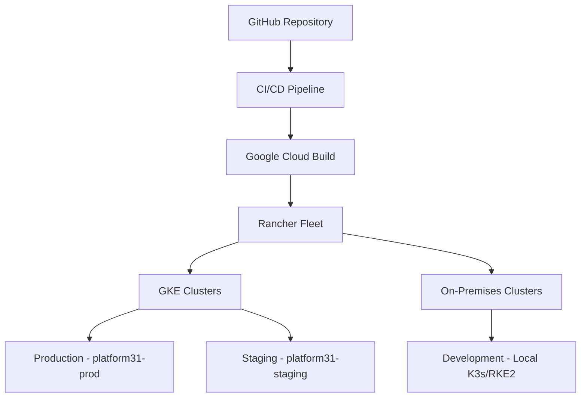

Building distributed systems across several environments is a structural problem before it is a tooling problem. A platform we recently documented, is our working example: clean boundaries between infrastructure provisioning, application logic, and service communication, drawn into a repository layout and held there by a short list of constraints.

The platform is deliberately boring. Its job is to be a predictable foundation for applications and microservices on any Kubernetes cluster you point it at, carrying the same source from cloud-native elasticity on Google Kubernetes Engine (GKE) to on-premises predictability on K3s or RKE2. That is also the interesting part: how far a small team can get by committing to a handful of constraints before writing code.

This note walks the C4 levels — context, containers, components — and then the cross-cutting decisions (data, deployment, observability, security) that the diagrams leave implicit. Where a topic has a standalone reference, it is linked inline to the docs: [microservices](https://docs.jampuk.com/devops-engineering/microservices/), [Dapr](https://docs.jampuk.com/devops-engineering/dapr-service-mesh/), [Kubernetes and Helm](https://docs.jampuk.com/devops-engineering/kubernetes-helm/), [Harbor and Fleet](https://docs.jampuk.com/devops-engineering/harbor-rancher-fleet/), [GitOps deploy flow](https://docs.jampuk.com/web-systems-delivery/gitops-deploy-flow/), and [Directus integration](https://docs.jampuk.com/devops-engineering/directus-dapr-integration/).

## 1. What the platform is

Platform31 is a codename for a client platform, and structurally it is one repository with three planes and a seam:

- **Infrastructure** — cluster definitions, cloud credentials, Fleet bundles and Helm charts for the core platform components. *Declared.*
- **Applications** — Helm charts and Fleet bundles for managed services we reuse across projects: Weaviate, Neo4j, MongoDB, PostgreSQL, Redis, Directus. *Configured.*
- **Microservices** — source code for the business logic, each one a Python/FastAPI service following Clean Architecture. *Coded.*
- **Dapr** — the seam between the last two: service discovery, state management, pub/sub and resiliency, so individual services do not have to implement any of it.

The three planes are not a filing convention. Each has a different owner, a different failure mode and a different kind of change; keeping them apart is what stops a DevOps change from becoming a developer change, and it keeps the blast radius of each small.

Everything is GitOps-driven: nothing is built or deployed from a laptop. The same repository layout deploys to GKE in production and staging, and to a local K3s or RKE2 cluster for development.

## 2. Context and scope

The system context is deliberately small: one system, three kinds of people and two kinds of infrastructure around it. That is a scope decision, not an oversight.

- **Developers** write and maintain microservices and applications.
- **DevOps engineers** manage infrastructure and deployments.
- **End users** use the applications deployed on the platform.

Those three work against a platform deployed to two external environments: Google Cloud Platform (project ID in the client's account, region `us-central1`) as primary, plus on-premises infrastructure.

```text
C4Context
title System Context diagram for Platform31
Enterprise_Boundary(b0, "Enterprise") {
  Person(developer, "Developer", "Develops and maintains microservices")
  Person(devops, "DevOps Engineer", "Manages infrastructure and deployments")
  Person(user, "End User", "Uses applications deployed on Platform31")
}
System(platform31, "Platform31", "Modular platform for applications and microservices")
Enterprise_Boundary(b1, "External Systems") {
  System_Ext(gcp, "Google Cloud Platform", "Cloud infrastructure provider")
  System_Ext(onprem, "On-Premises Infrastructure", "Local infrastructure")
}
Rel(developer, platform31, "Develops")
Rel(devops, platform31, "Manages")
Rel(user, platform31, "Uses")
Rel(platform31, gcp, "Deployed to")
Rel(platform31, onprem, "Deployed to")
```

The scope line that matters: Platform31 covers infrastructure management, application deployment and microservice orchestration. It does not cover feature code. A microservice is a tenant of the platform, not part of it. Drawing that line first is what lets the platform change without the services changing, and the services change without the platform changing.

## 3. Architectural goals and constraints

We wrote the constraints down before writing the code, because constraints are the part that actually shapes a system.

**Goals**

- **Maintainability** — Clean Architecture separates concerns so a change in one layer does not ripple through the others.
- **Scalability** — horizontal scaling of services, not bigger machines.
- **Resilience** — fault tolerance and recovery through Dapr (retries, circuit breakers, service discovery).
- **Observability** — logging, monitoring and tracing as defaults, not afterthoughts.
- **Security** — integrated at every level: RBAC, network policies, secret management.
- **Portability** — cloud (GKE) and on-premises (K3s/RKE2) from the same source.

**Structural constraints**

- Every microservice follows the defined Clean Architecture structure. No exceptions, no "just this once".
- Internal REST calls between microservices go through Dapr endpoints, never direct service URLs.
- Infrastructure and applications are declared; microservices are coded. A change does not cross that line silently.

**Operational constraints**

- All deployments go through CI/CD. No `kubectl apply` from a laptop.
- No local builds for deployment. Everything is GitOps-driven.
- Google Cloud is the primary provider: region `us-central1` (project ID withheld).
- All scripts must run on Windows (CMD and PowerShell) as well as Linux. This is not a nice-to-have; half the team is on Windows.

The last constraint is the one that bites hardest. It rules out a lot of "just use this bash script" shortcuts and pushes us toward containerized, cross-platform tooling. The point of writing them down first is that they are testable: a reviewer can reject a direct service URL, a manual deploy or a bash-only script without relitigating the architecture.

## 4. Container view

At the container level, Platform31 is four containers inside one boundary.

```text
C4Container
title Container diagram for Platform31
Person(developer, "Developer", "Develops and maintains microservices")
Person(devops, "DevOps Engineer", "Manages infrastructure and deployments")
Person(user, "End User", "Uses applications deployed on Platform31")
System_Boundary(platform_boundary, "Platform31") {
  Container(infrastructure, "Infrastructure", "Helm, Fleet", "Manages platform infrastructure")
  Container(applications, "Applications", "Helm, Fleet", "Provides managed services")
  Container(microservices, "Microservices", "Python, FastAPI", "Implements business logic")
  Container(dapr, "Dapr", "Service Mesh", "Provides service-to-service communication")
}
System_Ext(gcp, "Google Cloud Platform", "Cloud infrastructure provider")
System_Ext(onprem, "On-Premises Infrastructure", "Local infrastructure")
Rel(developer, microservices, "Develops")
Rel(devops, infrastructure, "Manages")
Rel(devops, applications, "Manages")
Rel(user, microservices, "Uses")
Rel(microservices, dapr, "Uses")
Rel(dapr, applications, "Connects to")
Rel(infrastructure, gcp, "Provisions")
Rel(infrastructure, onprem, "Provisions")
Rel(applications, gcp, "Deployed to")
Rel(applications, onprem, "Deployed to")
Rel(microservices, gcp, "Deployed to")
Rel(microservices, onprem, "Deployed to")
```

The mapping to the repository is intentionally one-to-one:

| Container | Repository path | Contents |
| --- | --- | --- |
| Infrastructure | `/infrastructure` | Rancher cluster definitions, cloud credentials, Fleet bundles, Helm charts for core components |
| Applications | `/applications` | Helm charts and Fleet bundles for managed services (Weaviate, Neo4j, MongoDB, PostgreSQL, Redis, Directus) |
| Microservices | `/microservices` | Source code for microservices, each following Clean Architecture |
| Dapr | (used across all) | Service-to-service communication, state management, pub/sub |

The reason this split matters: infrastructure and applications are *declared* (Helm + Fleet), microservices are *coded* (Python). The boundary between "what we configure" and "what we write" is the same boundary that separates a DevOps change from a developer change, and it keeps the blast radius of each small.

## 5. The component view: one microservice

A representative service — call it `core` — looks like this inside:

```text
C4Component
title Component diagram for a representative microservice
Container_Boundary(container_boundary, "representative microservice") {
  Component(application, "Application Layer", "FastAPI", "Use cases, API endpoints")
  Component(domain, "Domain Layer", "Python", "Core business models and rules")
  Component(adapters, "Adapters Layer", "Python", "Implementations of ports")
  Component(ports, "Ports Layer", "Python", "Interfaces for external systems")
  ComponentQueue(pubsub, "Dapr Pub/Sub", "Messaging", "Handles asynchronous communication")
  ComponentDb(statestore, "Dapr State Store", "Storage", "Manages state")
}
Rel(application, domain, "Uses")
Rel(application, ports, "Uses")
Rel(adapters, ports, "Implements")
Rel(domain, adapters, "Uses")
Rel(adapters, pubsub, "Publishes/Consumes")
Rel(adapters, statestore, "Reads/Writes")
```

And the directory structure that enforces it:

```text
src/
  application/   # use cases, FastAPI endpoints (or Reflex pages for UI)
  domain/        # core business models and rules
  adapters/      # implementations of ports: DB clients, Dapr integrations
  ports/         # interfaces for external systems: repositories, messaging
  main.py        # entry point
  __init__.py    # (and in every subdirectory)
tests/           # mirrors src/
```

The dependency rule is the whole point: dependencies point inward. The domain layer knows nothing about FastAPI, Dapr or MongoDB. Adapters implement ports; the application layer orchestrates use cases against those ports. That is what makes a service testable without spinning up a cluster, and what makes swapping a database a change in one adapter rather than a rewrite.

The [Microservices guide](https://docs.jampuk.com/devops-engineering/microservices/) in the docs has the directory structure, dependency rule and a checklist.

## 6. Integrating with managed services: Directus through Dapr

Directus is the platform's API management plane (headless CMS), declared under `/applications` like every other managed service. A microservice does not call Directus directly; it goes through Dapr, the same seam it uses for every other external system. That keeps Directus a detail at the edge of a service — an adapter implementing a port — rather than a dependency in its domain.

The integration has one quirk worth knowing up front: Dapr forwards the `Directus-Access-Token` header as a query parameter to Directus, so the token travels in the request URL. Two access levels cover every case — a user's token for on-behalf-of operations, and an `ADMIN_TOKEN` (from the environment) for administrative actions. The full guide, with code examples and best practices, lives in the docs: [Directus integration with Dapr](https://docs.jampuk.com/devops-engineering/directus-dapr-integration/).

```python
from dapr.clients import DaprClient

async def get_user_items(user_token: str):
    async with DaprClient() as d:
        response = await d.invoke_method(
            app_id='directus',
            method_name=f'items/some_collection?access_token={user_token}',
            http_verb='GET'
        )
        return response.json()
```

The rules that keep this honest: never expose `ADMIN_TOKEN` client-side or commit it; use user-level tokens whenever possible (least privilege); and keep the Dapr call inside an adapter so the domain never sees Directus. This is the same "no secrets in Git" discipline as section 13.

## 7. Technology stack

| Area | Choice |
| --- | --- |
| Language (microservices) | Python |
| API framework | FastAPI |
| UI framework | Reflex |
| Service mesh | Dapr (service-to-service, state, pub/sub) |
| Containerization | Docker |
| Orchestration | Kubernetes (K8s) |
| Cluster management | Rancher |
| GitOps | Rancher Fleet |
| CI/CD | GitHub Actions + Google Cloud Build |
| Container registry | Harbor (private, Let's Encrypt TLS) |
| IaC | Helm charts, Rancher cluster definitions |
| Databases | MongoDB, Neo4j, PostgreSQL, Redis |
| API management | Directus (headless CMS) |
| Search | Weaviate (vector search) |

The stack is deliberately boring. Every choice is either a CNCF standard or a managed service we can hand over. The point is not novelty; it is that a new engineer can read the repository and know where everything lives.

## 8. Data view: polyglot persistence

Platform31 does not pick one database. It picks the right store for each job and keeps ownership with the service that owns the data.

- **MongoDB** — document store for flexible schemas.
- **Neo4j** — graph database for relationship-heavy data.
- **PostgreSQL** — relational, ACID, structured data.
- **Redis** — in-memory cache and session store.
- **Weaviate** — vector search for AI-powered retrieval.



Dapr is the seam. A service talks to Dapr's state API; Dapr talks to whichever store is configured for that component. That is what makes the data layer swappable per environment without code changes, and it is what keeps the "data ownership" rule honest: each service owns its data, and no service reaches into another service's store directly.

The Dapr page covers component configuration and the state/pub/sub patterns: [Dapr service mesh](https://docs.jampuk.com/devops-engineering/dapr-service-mesh/).

## 9. Deployment and infrastructure

The deployment model is GitOps end to end, with three environments.



- **Cloud**: GKE clusters — production (`platform31-prod`) and staging (`platform31-staging`).
- **Local development**: self-contained inside each microservice's directory, using `docker-compose.yml` and Dapr component files. No cluster required to run one service.
- **GitOps**: Rancher Fleet reconciles desired state from Git.
- **IaC**: Helm charts and Rancher cluster definitions.
- **CI/CD**: GitHub Actions workflows build and deploy.
- **Registry**: Harbor, private, one pull-only robot account per project; credentials are delivered by Fleet, never typed on a laptop.

The local-development story is worth emphasizing: a developer can run a single microservice with its Dapr sidecar and a local store, without standing up Kubernetes. That keeps the feedback loop short and is the main reason the Clean Architecture boundary pays off — the domain and application layers run anywhere Python runs.

## 10. Private images: Harbor, Fleet and the pull path

Every image in the deployment path above comes from a private Harbor registry rather than a public one. That makes registry authentication part of the delivery mechanism, not a footnote: a node that cannot authenticate cannot start a pod, however correct the Git state is.

Harbor is served over TLS with a Let's Encrypt certificate. Modern containerd trust stores already include the ISRG roots, so a default node image needs no extra CA configuration — but we verify that against the actual on-prem node image before rolling out a new cluster, because an older base image is exactly where the assumption fails quietly.

**Pull-only credentials.** Automation authenticates with a Harbor robot account, scoped to the projects it needs and to pull only. It is not a person's account, so it survives staff changes and rotates without a laptop. It surfaces as a `kubernetes.io/dockerconfigjson` secret, and it never appears in the repository — section 13 covers why that sentence is not decorative.

**One setting, or one secret per namespace.** Rancher can hold the registry globally, under Global Settings → Registries, which lets it authenticate provisioned RKE2 and K3s clusters at the runtime level — the least repetitive option where Rancher owns the node configuration. It does not extend to hosted GKE, where the node runtime belongs to the provider, so the portable form has to exist as well: a pull secret kept in encrypted form in Git and applied to the workload namespace by Fleet, or copied downstream by a HelmOp. Both mechanisms are legitimate; what matters is that the secret is delivered by the same system that deploys the workload.

**Why "no kubectl" is also a reliability rule.** A workload deployed through Fleet receives the pull secret; one applied directly with `kubectl` does not, and fails with `ImagePullBackOff` even though the registry is reachable. The constraint in section 3 is usually argued on auditability grounds. Here the runtime enforces it.

## 11. Cross-cutting concerns

**Logging.** Centralized through the Kubernetes/Rancher monitoring stack, structured in every microservice. No `print` in production code.

**Monitoring.** Prometheus and Grafana for metrics, health checks in every service, Dapr's built-in observability on top. A service that has no health endpoint is not deployable.

**Security.** Secrets through Rancher/Vault, network policies and RBAC in Kubernetes, secure service-to-service communication via Dapr. Credentials never live in the repository — a lesson we learned the hard way, see section 13.

**Error handling and resiliency.** Standardized error patterns, circuit breakers and retry policies through Dapr, graceful degradation when a downstream service is unavailable. Dapr handles the mechanics; we handle the policy (which calls get retries, which get circuit breakers, what the fallback is).

## 12. Architecture decision records

Significant decisions are recorded as ADRs so the reasoning survives the people who made it. The first one is the foundation:

- **ADR-0001: Standardized Folder Structure and Clean Architecture Principles** — the directory layout, the dependency rule, and the rule that every microservice follows them.

More ADRs land as decisions are made. The discipline that makes ADRs worth writing: record the decision and the rejected alternatives, not just the winner. A decision without its alternatives is a fact; with them, it is reasoning.

## 13. The unglamorous lessons

Two things we got wrong before we got them right, and that shaped the constraints above.

First, **credentials in the repository**. An early audit found production database and ERP credentials committed in source. They were rotated immediately and treated as compromised. The replacement pattern: generate fresh secrets into a git-ignored environment file at deploy time, and regenerate the app's database config inside the container at start, rather than editing it in place. The constraint "no secrets in Git" is not aspirational; it is the scar tissue from that audit.

Second, **health checks that lie**. A database ping returns success even when authentication is refused, so a "healthy" service can be one nobody can actually connect to. Health checks are authenticated queries as the app user. The migrator makes the same distinction: a refused login is fatal on the first attempt and prints the fix; a server still starting is waited out.

## 14. Glossary

- **ADR** — Architecture Decision Record.
- **Clean Architecture** — separation of concerns into layers with an inward-pointing dependency rule.
- **Dapr** — Distributed Application Runtime: service discovery, state, pub/sub, resiliency.
- **Fleet** — Rancher Fleet, GitOps delivery for Kubernetes.
- **GitOps** — Git as the single source of truth for declarative infrastructure and apps.
- **GKE** — Google Kubernetes Engine.
- **Harbor** — private container registry; images are pulled with a project-scoped, pull-only robot account.
- **Helm** — Kubernetes package manager.
- **Image pull secret** — a `kubernetes.io/dockerconfigjson` secret a kubelet uses to authenticate to a private registry.
- **K3s / RKE2** — lightweight/conformant Kubernetes for on-prem and edge.
- **Microservice** — independently deployable service with a well-defined API.

## Guides and references

- [Microservices](https://docs.jampuk.com/devops-engineering/microservices/) — Clean Architecture structure, dependency rule and testing.
- [Dapr service mesh](https://docs.jampuk.com/devops-engineering/dapr-service-mesh/) — state, pub/sub and resiliency patterns.
- [Kubernetes and Helm](https://docs.jampuk.com/devops-engineering/kubernetes-helm/) — cluster and chart foundations.
- [Harbor and Rancher Fleet](https://docs.jampuk.com/devops-engineering/harbor-rancher-fleet/) — private registry credentials for GitOps deploys.
- [GitOps deploy flow](https://docs.jampuk.com/web-systems-delivery/gitops-deploy-flow/) — pull-based delivery.
- [Docker foundations](https://docs.jampuk.com/devops-engineering/docker-foundations/) — container baselines.
- [Directus integration with Dapr](https://docs.jampuk.com/devops-engineering/directus-dapr-integration/) — authenticating to Directus through Dapr (user and admin tokens).
