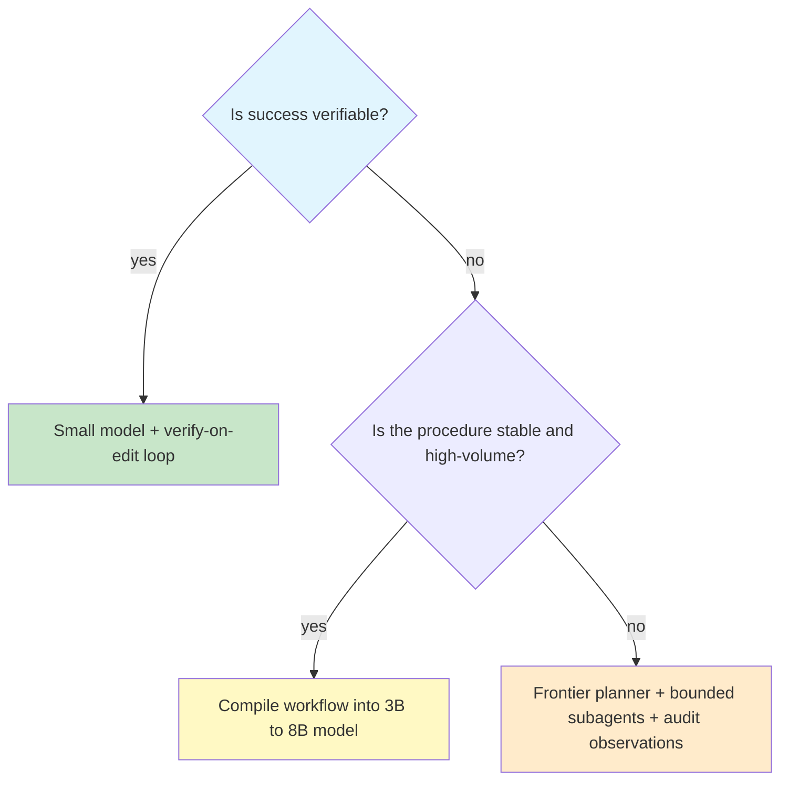

The default architecture for AI agents is still a frontier model running in a loop. It's the easiest thing to buy and the hardest to justify line by line. You pay for a high reasoning ceiling on every single turn: reading stack traces, retrying malformed tool calls, rewriting files after tests already passed.

But new evidence shows the loop itself contributes more to success than parameter count. The right architecture can let a small model punch well above its weight class.[^1]

### Small models + good loops can rival frontier models

Structured work with verifiable success signals responds dramatically to [loop design](https://docs.jampuk.com/ai-integrations/verifiable-execution-loops/):

- **A 3B active Mixture-of-Experts model** landed within 2.2 percentage points of Claude Opus 4.6 on verified coding tasks once a test-driven loop ran after every edit.[^2]
- **A 6B active model** exceeded Claude Opus 4.6 Max on SWE-bench Pro.[^3][^4]
- **An 8B compiled workflow** reached 92% to 98% of the in-context baseline across quality dimensions at 1/128 to 1/462 of the per-conversation cost.[^5]

The loop is doing the work, and badly built scaffolds give those gains right back.

### Three architectures that move capability into the loop

**[1. Verifiable execution loops](https://docs.jampuk.com/ai-integrations/verifiable-execution-loops/)**: After every file modification, the agent runs relevant tests. The constraint prevents stacking changes on a broken state. It costs more turns, but buys a search signal correlated with the actual objective.[^2] *Key takeaway: Test-after-every-edit prevents cascading failures.*

**[2. Compiling procedures into weights](https://docs.jampuk.com/ai-integrations/workflow-compilation/)**: Instead of having a frontier model re-read the same procedure in every conversation, embed deterministic workflow knowledge directly into a small model's weights. Context drops to a constant scale, and the compiled model fails less often because there's no runtime translation layer.[^5] *Key takeaway: Pay once to compile; run cheaply every time after.*

**[3. Heterogeneous de-aggregation and routing](https://docs.jampuk.com/ai-integrations/agent-delegation-routing/)**: Split the system by capability: a frontier model as planner/router, narrow execution tasks delegated to compact subagents. Offloading shell operations to a specialized subagent can save 740,000+ main-agent tokens per interaction while keeping accuracy intact.[^6] *Key takeaway: Don't pay frontier prices for repetitive execution.*

### Where scaffolds cost more than they return

Five common failure modes, and how to avoid them:

| Failure mode | Why it happens | How to fix it |
|---|---|---|
| **JSON pipeline cliff** | Small models struggle with complex multi-turn JSON schemas; format compliance breaks down and cascades[^7] | Use plain-text messaging; validate at boundaries; enforce rigid decoding |
| **Coercive over-correction** | Refinement prompts force changes to working code even when no failure exists[^7] | Refine only on explicit verifier failure; use non-coercive prompts |
| **Unnecessary paradigm overhead** | Applying reflection/chain-of-thought universally wastes tokens[^8] | Route by task with a Select-then-Solve classifier |
| **Execution context bloat** | Main agent carries every line of shell output for the entire session[^6] | Delegate verbose operations to bounded subagents |
| **Silent enterprise violation** | Asynchronous background state changes (e.g., permission edits) are invisible in tool output[^9] | Expand observation space to audit logs, event streams, change data capture |

Each failure has a longer diagnosis and fix in the [agent scaffold failure modes reference](https://docs.jampuk.com/ai-integrations/agent-scaffold-failure-modes/).

### A decision guide for your team

The practical question isn't "which model is best?"; it's "which architecture does this task justify?" The [agent architecture decision guide](https://docs.jampuk.com/ai-integrations/agent-architecture-decision-guide/) turns that into a task inventory, an architecture matrix, and a set of procurement rules.



```text
Is success verifiable by an external check?
  yes → small model + verify-on-edit loop
  no  → is the procedure stable and high-volume?
           yes → compile the workflow into a 3B to 8B model
           no  → frontier planner + bounded subagents + audit observations
```

### Six rules for procurement and architecture

1. **Buy feedback before parameters.** If you can test the output, a smaller model is viable. If you can't test it, a larger model only buys you a wider margin before failure becomes visible, not immunity.[^1]

2. **Compile the stable path.** Don't pay a frontier model to re-read the same procedure in every conversation. Compile it once and version the artifact like any other deployable. See [workflow compilation](https://docs.jampuk.com/ai-integrations/workflow-compilation/) for the artifact lifecycle.

3. **Reserve the frontier for ambiguity.** Planning, intent resolution, exception handling, and routing are worth the premium. Repeating a fixed sequence of tool calls is not.

4. **Refine only on failure.** Use non-coercive prompts, explicit verifier codes, and a skip path when the candidate passes. A refinement loop without a failure gate generates regressions.

5. **Measure cost per successful task.** Token price is an input. Resolved tasks and constrained successes are the output. A cheaper model with a lower success rate can be the more expensive system.[^9] See [cost per successful task](https://docs.jampuk.com/ai-integrations/cost-per-successful-task/) for the telemetry.

6. **Make side effects visible.** Audit observations are part of the agent's interface, not an afterthought. If the agent can't see a permission change or background job, it can't be trusted with dependent constraints. See [agent audit and observability](https://docs.jampuk.com/ai-integrations/agent-audit-observability/) for the observation model.

### What this changes about the frontier

The frontier model doesn't disappear; it moves up the stack. In a heterogeneous topology, it becomes the planner, router, ambiguity resolver, and exception handler. It's the component you call when the procedure breaks, not the one that executes every step. That's a better use of its capability and its cost.

The small model doesn't become a frontier model. It becomes a reliable executor inside a system that knows how to check its work. You're not buying a model; you're buying a loop with a model inside it. The loop is what you can test, version, and improve.

### The bottom line

The unglamorous work - test harnesses, read-only evaluators, workflow compilation, routing policies, audit logs, cost telemetry - is the shape of successful AI integrations. The model is a component. The system around it is what ships.

If you are designing that loop, the work is unglamorous: test harnesses, read-only evaluators, workflow compilation, routing policies, audit logs, and cost telemetry. That is the shape of our [AI integrations](https://www.jampuk.com/solutions/ai-integrations) and [document intelligence](https://www.jampuk.com/agentic-grid/document-intelligence) engagements, and it is the same discipline behind our [compliance engineering](https://www.jampuk.com/resources/compliance/) work.

### Further reading

- [Agent architecture decision guide](https://docs.jampuk.com/ai-integrations/agent-architecture-decision-guide/) - task inventory, architecture matrix, and procurement rules.
- [Verifiable execution loops](https://docs.jampuk.com/ai-integrations/verifiable-execution-loops/) - the edit-check-repair contract and read-only evaluators.
- [Workflow compilation](https://docs.jampuk.com/ai-integrations/workflow-compilation/) - when to compile a procedure and how to version the artifact.
- [Agent delegation and routing](https://docs.jampuk.com/ai-integrations/agent-delegation-routing/) - planner-led topologies and bounded subagents.
- [Agent audit and observability](https://docs.jampuk.com/ai-integrations/agent-audit-observability/) - expanding the observation space beyond tool output.
- [Cost per successful task](https://docs.jampuk.com/ai-integrations/cost-per-successful-task/) - the economics of retries, reviews, and delegation.
- [Agent scaffold failure modes](https://docs.jampuk.com/ai-integrations/agent-scaffold-failure-modes/) - diagnosis and fixes for the five common failures.

## Sources

[^1]: NVIDIA, "Small Language Models are the Future of Agentic AI," arXiv:2506.02153. https://arxiv.org/abs/2506.02153
[^2]: r/LocalLLaMA, "Qwen3.5-35B-A3B hits 37.8% on SWE-bench Verified Hard - nearly matching Claude Opus 4.6 (40%) with the right verification strategy," March 2026. https://www.reddit.com/r/LocalLLaMA/comments/1rkdlqi/qwen3535ba3b_hits_378_on_swebench_verified_hard/
[^3]: DataCamp, "Qwen3.8-Flash-Next: Features, Benchmarks, and Pricing," August 2026. https://www.datacamp.com/blog/qwen3-8-flash-next
[^4]: Scale Labs, "SWE-bench Pro Leaderboard." https://labs.scale.com/leaderboard/swe_bench_pro
[^5]: "Compiling Agentic Workflows into LLM Weights: Near-Frontier Quality at Two Orders of Magnitude Less Cost," arXiv:2605.22502. https://arxiv.org/abs/2605.22502
[^6]: "Terminus-4B: Can a Smaller Model Replace Frontier LLMs at Agentic Execution Tasks?" arXiv:2605.03195. https://arxiv.org/abs/2605.03195
[^7]: "Two Calls Beat Five Agents: Evaluating Multi-Agent Pipelines Against Self-Refinement for Local Language Models," arXiv:2607.26922. https://arxiv.org/abs/2607.26922
[^8]: "Select-then-Solve: Paradigm Routing as Inference-Time Optimization for LLM Agents," arXiv:2604.06753. https://arxiv.org/abs/2604.06753
[^9]: "World of Workflows: a Benchmark for Bringing World Models to Enterprise Systems," arXiv:2601.22130. https://arxiv.org/abs/2601.22130
